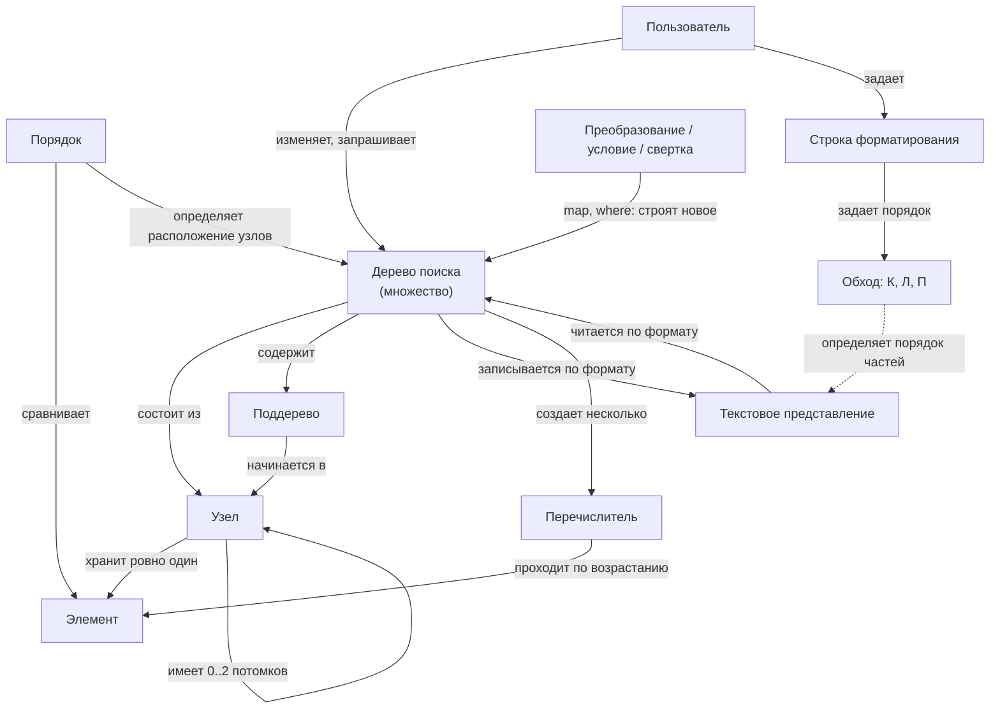
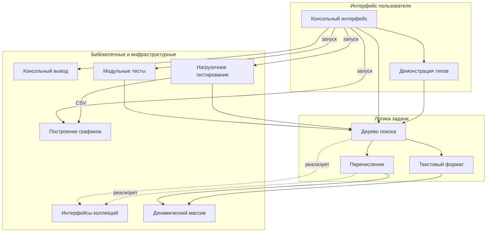
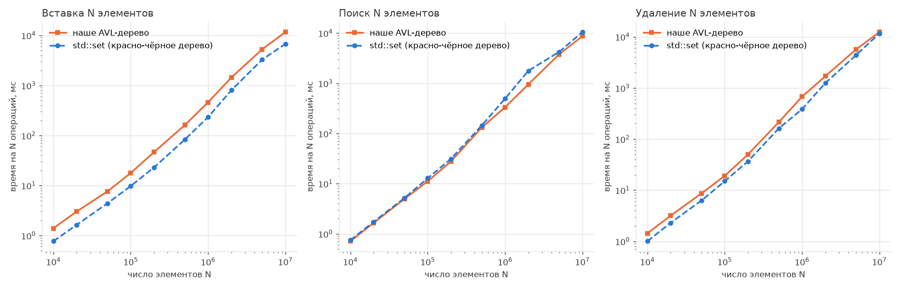

# Лабораторная работа №1. Дерево поиска (AVL)

Шаблонное сбалансированное бинарное дерево поиска с функциями высшего порядка, работой с поддеревьями, сохранением в строку и чтением из строки по формату обхода. В работе есть консольное меню, модульные тесты и нагрузочное тестирование до 10⁷ элементов (10⁸ — отдельный режим) с графиками.

Документ состоит из двух частей. **Дизайн** (разделы 1–4) — анализ задачи и придуманное решение, без деталей физической реализации. **Реализация** (разделы 5–10) — как решение воплощено в коде, как его собрать, проверить и какие получились результаты.

---

# Часть I. Дизайн

## 1. Постановка задачи

### 1.1. Что делается в работе

Строится универсальная структура данных — **упорядоченное множество** на основе бинарного дерева поиска. Она хранит уникальные элементы любого типа, для которого задан порядок, и поддерживает:

- основные операции множества: добавить, найти, удалить элемент, узнать их число, получить k-й по порядку;
- **автоматическую балансировку** (AVL), чтобы все основные операции выполнялись за логарифмическое время независимо от порядка поступления данных;
- **функции высшего порядка**: преобразование всех элементов (`map`), отбор по условию (`where`), свертку в одно значение (`reduce`), слияние множеств;
- работу с **поддеревьями**: извлечение поддерева по корню и проверку вхождения поддерева;
- **сохранение в строку и чтение из строки** с порядком обхода, который задает пользователь строкой форматирования, например `{К}(Л)[П]`;
- **единые интерфейсы коллекции**: число элементов, проверка наличия, доступ по индексу, последовательный перебор.

Для проверки решения нужны консольный интерфейс, модульные тесты и замеры скорости на больших (10⁴–10⁵) и очень больших (10⁶–10⁸) объемах данных.

### 1.2. Зачем это нужно

Упорядоченное множество — базовый строительный блок для класса задач, где нужно **быстро искать данные и одновременно поддерживать их порядок** при частых изменениях:

- индексы в базах данных и поиск по ключу (номер зачетки, табельный номер, идентификатор);
- словари и справочники, которым нужен перебор в алфавитном порядке;
- задачи, где нужны k-й по величине элемент, минимум и максимум, диапазоны;
- сохранение и восстановление структуры данных (передача между программами, запись в файл) — для этого нужно текстовое представление, по которому дерево восстанавливается однозначно.

В отличие от отсортированного массива, изменение множества не требует сдвига элементов (O(log N) вместо O(N)). В отличие от хеш-таблицы, элементы всегда доступны в порядке возрастания.

### 1.3. Объем работы

Выбранные составляющие из таблицы задания:

| № | Составляющая | Рейтинг |
|---|---|---|
| 1 | Бинарное дерево поиска: вставка, поиск, удаление | 5 |
| 1.1 | Балансировка | 2 |
| 1.2 | `map`, `reduce`, `where` | 3 |
| 1.4.1 | Сохранение в строку по фиксированному обходу | 1 |
| 1.4.2 | Сохранение в строку по обходу, заданному строкой форматирования | 3 |
| 1.5.1 | Чтение из строки по фиксированному обходу | 1 |
| 1.5.2 | Чтение из строки по обходу, заданному строкой форматирования | 4 |
| 1.6 | Извлечение поддерева по заданному корню | 2 |
| 1.7 | Поиск на вхождение поддерева | 3 |
| 7.1 | Интерфейс `ICollection` | 2 |
| 7.2 | Интерфейс `IEnumerable` и перечислитель дерева | 3 |
| 7.3 | Перегрузка операторов | 2 |
| | **Итого** | **31** (минимум — 25) |

Типы хранимых элементов — все, что указаны в задании для бинарного дерева: целые, вещественные и комплексные числа, строки, функции, студенты и преподаватели.

---

## 2. Сущности прикладной задачи

### 2.1. Сущности

| Сущность | Описание |
|---|---|
| **Элемент** | Хранимое значение: число, строка, функция, студент, преподаватель. Элементы в дереве уникальны. |
| **Порядок** | Правило сравнения «меньше» для элементов. Задает расположение элементов в дереве. Два элемента, ни один из которых не меньше другого, считаются одинаковыми. Для одного типа может быть несколько порядков (например, студенты — по номеру зачетки, комплексные числа — по модулю). |
| **Дерево поиска** | Множество элементов, организованное иерархически: у каждого узла все элементы левого поддерева меньше, а правого — больше его элемента. Дерево **сбалансировано**: у каждого узла высоты левого и правого поддеревьев различаются не больше чем на 1. |
| **Узел** | Позиция элемента в дереве. У узла не больше двух потомков — левый и правый. Узел без потомков — лист, узел без родителя — корень. |
| **Поддерево** | Узел вместе со всеми его потомками. Поддерево дерева поиска само является деревом поиска. |
| **Обход** | Порядок, в котором для каждого узла посещаются три его части: корень (К), левое поддерево (Л), правое поддерево (П). Всего 6 вариантов: КЛП, КПЛ, ЛКП, ЛПК, ПКЛ, ПЛК. |
| **Строка форматирования** | Описание обхода и ограничителей частей: три буквы К, Л, П в выбранном порядке, каждая в своих скобках, например `{К}(Л)[П]`. |
| **Текстовое представление** | Строка, однозначно описывающая дерево: значения и форму (кто чей потомок), построенная по строке форматирования. Например, `{2}({1}()[])[{3}()[]]`. |
| **Функция преобразования, условие, функция свертки** | Параметры операций `map`, `where`, `reduce`: что сделать с каждым элементом, какие элементы оставить, как накопить результат. |
| **Перечислитель** | Курсор для последовательного перебора элементов дерева по одному, в порядке возрастания. По одному дереву может одновременно идти несколько независимых перечислителей. |
| **Пользователь** | Работает с деревом через консоль: вводит элементы, команды, строки форматирования и текстовые представления. |

### 2.2. Связи



Те же связи словами:

- дерево **состоит из** узлов; каждый узел **хранит** ровно один элемент и **имеет** до двух потомков (левый и правый);
- порядок **сравнивает** элементы и тем самым **определяет**, где в дереве окажется каждый узел; одинаковые по порядку элементы в дереве не повторяются;
- каждое поддерево **начинается** в каком-то узле и **принадлежит** дереву;
- строка форматирования **задает** обход и скобки; по дереву и строке форматирования **строится** текстовое представление, а из текстового представления и той же строки **восстанавливается** дерево;
- преобразование и условие вместе с деревом **дают новое** дерево; свертка вместе с деревом и начальным значением дает одно значение;
- дерево **создает** перечислители; каждый **проходит** элементы по возрастанию независимо от остальных;
- пользователь **изменяет** дерево и **запрашивает** результаты, **задает** строки форматирования.

---

## 3. Архитектура

### 3.1. Компоненты

| Компонент | Вид | Назначение |
|---|---|---|
| **Консольный интерфейс** | UI (CLI) | Меню, ввод данных и команд, вывод результатов, рисунок дерева, сообщения об ошибках |
| **Демонстрация типов** | UI | Показ работы дерева с остальными типами элементов |
| **Дерево поиска** | логика задачи | Хранение элементов, основные операции, балансировка, функции высшего порядка, поддеревья, операторы, проверка корректности |
| **Текстовый формат** | логика задачи | Разбор строки форматирования, обходы, запись дерева в строку и чтение из строки |
| **Перечисление** | логика задачи | Последовательный перебор элементов дерева |
| **Интерфейсы коллекций** | библиотечный | Общие контракты `ICollection`, `IEnumerable`, `IEnumerator` |
| **Динамический массив** | библиотечный (из ДЗ-1) | Хранение списков элементов и стека перечислителя |
| **Консольный вывод** | инфраструктурный (из ДЗ-1) | Окна, цвета, выравнивание текста в консоли |
| **Модульные тесты** | инфраструктурный | Проверка корректности всех операций |
| **Нагрузочное тестирование** | инфраструктурный | Замеры времени, сравнение с аналогом, выгрузка в CSV |
| **Построение графиков** | инфраструктурный (внешний скрипт) | График зависимости времени от числа элементов по CSV |

### 3.2. Связи между компонентами



Зависимости направлены сверху вниз: логика задачи не знает об интерфейсе пользователя, а базовые компоненты — о дереве. Интерфейс пользователя, тесты и замеры пользуются только открытыми операциями дерева и не видят его внутреннего устройства.

### 3.3. Описание компонентов, алгоритмов и решений

#### Дерево поиска

**Структура данных.** Дерево — это корневой узел и правило сравнения. Каждый узел хранит:

- элемент;
- двух потомков (левого и правого);
- **высоту** своего поддерева — нужна для балансировки;
- **размер** своего поддерева (число узлов) — нужен для подсчета элементов и доступа к k-му элементу.

Высота и размер хранятся, а не вычисляются заново: после любого изменения потомков узел пересчитывает их по потомкам за O(1).

**Решение: единственный владелец узла.** Каждым узлом владеет ровно один родитель (корнем — само дерево). Удаление узла удаляет все его поддерево, поэтому утечки и двойное освобождение исключены. Остальные компоненты (поиск, перечисление, запись в строку) только просматривают узлы, не владея ими. Копия дерева глубокая (каждый узел копируется), а передача дерева (например, результата функции) переносит только корень и не зависит от размера.

**Решение: порядок — параметр структуры.** Дерево сравнивает элементы только через правило сравнения, которое задается вместе с типом элемента (по умолчанию — обычное «меньше»). Это позволяет хранить типы без встроенного порядка (комплексные числа, функции) и разные порядки для одного типа. Равенство выводится из порядка: «ни один не меньше другого».

**Решение: множество.** Элементы уникальны: повторная вставка не меняет дерево. Это естественно для дерева поиска и упрощает поиск поддеревьев (см. ниже).

**Поиск.** Спуск от корня: меньше — влево, больше — вправо, равно — найдено, пустое место — элемента нет. O(h), где h — высота.

**Вставка.** Спуск до пустого места, где должен стоять элемент; там создается лист. Затем на **обратном пути** к корню каждый узел пути пересчитывает высоту и размер и при необходимости балансируется.

**Балансировка (AVL).** Баланс узла — разность высот левого и правого поддеревьев; допустимы −1, 0, +1. При ±2 выполняется поворот — перестановка трех связей, которая сохраняет порядок элементов и выравнивает высоты:

- **малый поворот** — если потомок с высокой стороны перекошен в ту же сторону или ровный;
- **большой поворот** (два малых: сначала у потомка, потом у узла) — если потомок перекошен в противоположную сторону («излом»).

```
малый правый поворот:            большой поворот (лево-право):
        y                x            z            z           y
       / \              / \          /            /           / \
      x   C     →      A   y        x      →     y     →     x   z
     / \                  / \        \          /
    A   B                B   C        y        x
```

Высота AVL-дерева не больше ≈ 1,44·log₂N: минимальное число узлов в дереве высоты h растет как числа Фибоначчи. Поэтому все операции «по одному пути» — O(log N). После вставки достаточно не более одного поворота, после удаления их может быть до O(log N) (по одному на уровень), каждый за O(1).

**Удаление.** Спуск к узлу, затем три случая:

- лист — убрать;
- один потомок — поставить потомка на место узла;
- два потомка — записать в узел **наименьший элемент правого поддерева** (он больше всех слева и меньше всех справа) и удалить тот узел; у него нет левого потомка, так что это один из простых случаев.

На обратном пути — балансировка.

**k-й элемент.** В порядке возрастания перед узлом стоят ровно элементы его левого поддерева, поэтому размер левого поддерева — это номер узла. Сравнивая искомый номер с ним, спускаемся влево, останавливаемся или уходим вправо, вычитая пропущенное. O(log N). Число всех элементов — размер корня, O(1).

**Функции высшего порядка.** Строятся на симметричном обходе (ЛКП), который выдает элементы по возрастанию.

- `map` и `where` строят **новое** дерево вставками: преобразование может нарушить порядок (например, смена знака) или склеить разные элементы в один (например, возведение в квадрат), поэтому форму исходного дерева копировать нельзя. O(N log N).
- `reduce(f, c)` проходит элементы по возрастанию: `f(aₙ, … f(a₂, f(a₁, c)))`, как в определении задания. O(N). В примере задания правильный результат — **144**, а не 132: `f(1, 4) = 14`, `f(2, 14) = 46`, `f(3, 46) = 144` (в тексте задания на последнем шаге подставлено 42 вместо 46).
- Слияние — копия первого дерева плюс вставка элементов второго.

**Поддеревья.**

- Извлечение — найти узел и глубоко скопировать его со всеми потомками. Результат — тоже сбалансированное дерево поиска. O(log N + K), K — размер поддерева.
- Проверка вхождения: поддерево входит, если в дереве есть узел, начиная с которого совпадают и значения, и форма. Поскольку элементы уникальны, корень образца может совпасть только с одним узлом, и он находится обычным поиском, а не перебором всех узлов. Затем формы сравниваются рекурсивно. O(log N + M) вместо O(N·M) в общем случае.

**Проверка корректности.** Два инварианта: порядок (обход по возрастанию строго возрастает) и баланс с верными высотами и размерами в каждом узле. Используется в тестах и при чтении из строки.

#### Текстовый формат

**Формат.** Каждая часть узла — в своих скобках, в порядке, заданном строкой форматирования; пустое поддерево — пустые скобки:

```
     2
    / \          {К}(Л)[П]   →   {2}({1}()[])[{3}()[]]
   1   3         (Л){К}[П]   →   ((){1}[]){2}[(){3}[]]
```

**Решение: явные границы.** Скобки отмечают начало и конец каждого поддерева, включая пустые, поэтому по строке форма дерева восстанавливается **однозначно** при любом из шести порядков. Последовательность значений без таких пометок форму не определяет.

**Решение: свобода скобок.** Для каждой части слева можно взять любую из `( [ { <`, справа — любую из `) ] } >`, в том числе разные, как в примере задания `{1]К[2][3}`. Разбор однозначен, потому что открывающие и закрывающие скобки — разные наборы символов. Значение не может содержать закрывающую скобку своей части; для таких значений выбирается другой формат (например, `<К>(Л)[П]`). Невозможность записи обнаруживается **при записи**, а не при последующем чтении.

**Разбор строки форматирования.** Последовательно читаются три части: скобка, буква, скобка; проверяется, что буквы не повторяются и лишних символов нет. Разобранный формат не зависит от типа элементов и передается дальше уже проверенным.

**Запись.** Рекурсивно для каждого узла по трем частям формата: открыть скобку — записать значение или поддерево — закрыть скобку. O(N).

**Чтение — рекурсивный спуск.** Формат рекурсивен («узел — это три части, часть — скобка, затем значение, узел или ничего, затем скобка»), и разбор повторяет его: на каждый узел — один рекурсивный шаг. Если сразу за открывающей скобкой стоит закрывающая, поддерево пустое. После разбора проверяется корректность дерева: синтаксически правильная строка может описывать дерево с нарушенным порядком или без баланса — такое не принимается. O(N).

**Обходы.** Тот же разобранный формат задает обход в список: для каждого узла выполняются три шага в порядке букв. Одна процедура обслуживает все шесть обходов.

**Фиксированный обход** — формат по умолчанию `{К}(Л)[П]`.

#### Перечисление

**Решение: курсор отдельно от дерева.** Позиция перебора хранится в отдельном объекте-перечислителе, а не в дереве. Поэтому по одному дереву может идти несколько независимых переборов (например, вложенные циклы), а само дерево при переборе не меняется.

**Алгоритм.** Узлы знают только своих потомков, поэтому для возврата к предкам перечислитель хранит **стек** пройденного пути:

1. в начале — спуститься от корня влево до упора, складывая узлы в стек;
2. на каждом шаге — снять верхний узел (это следующий по возрастанию), затем спуститься влево до упора от его правого потомка.

Память O(h) = O(log N). Каждый узел кладется и снимается один раз: весь перебор — O(N), один шаг — в среднем O(1).

#### Интерфейсы коллекций

- `ICollection` — число элементов, проверка наличия, элемент по индексу (k-й по возрастанию);
- `IEnumerable` — выдать новый перечислитель;
- `IEnumerator` — перейти к следующему, текущий элемент, сброс в начало.

Код, знающий только интерфейс, работает с деревом, не зная его устройства.

#### Консольный интерфейс

Меню в стиле ДЗ-1 работает с деревом целых чисел. Дерево рисуется сверху вниз (если помещается на экран), рядом выводятся шесть обходов. Любая ошибка ввода или операции выводится сообщением, программа продолжает работу.

#### Нагрузочное тестирование

**Методика.**

- Для каждого N генерируются N случайных ключей с фиксированным seed (повторяемость). Отсортированные данные — особый случай; случайные отражают обычную работу.
- Замеряются вставка всех ключей, поиск каждого и удаление каждого.
- Для маленьких N берется лучший из трех запусков: внешние помехи могут только замедлить работу.
- Для сравнения то же самое выполняется на стандартном упорядоченном множестве (красно-черное дерево). Это эталон: он показывает, насколько реализация близка к промышленной, и иллюстрирует разницу AVL и красно-черного дерева.
- Результаты выгружаются в CSV, по ним строится график в логарифмическом масштабе.

#### Сложность операций

| Операция | Время | Почему |
|---|---|---|
| поиск, вставка, удаление | O(log N) | один путь от корня, h ≤ 1,44·log₂N; балансировка O(1) на узел пути |
| число элементов, высота, проверка на пустоту | O(1) | хранятся в корне |
| k-й элемент | O(log N) | спуск по размерам левых поддеревьев |
| `map`, `where`, слияние | O(N log N) | результат строится N вставками |
| `reduce`, обходы, запись и чтение строки, сравнение деревьев | O(N) | каждый узел по одному разу |
| извлечение поддерева | O(log N + K) | поиск корня и копирование K узлов |
| проверка вхождения поддерева | O(log N + M) | элементы уникальны: корень образца ищется спуском |
| перечислитель: весь обход / один шаг | O(N) / в среднем O(1) | память O(log N) |
| копирование / передача дерева | O(N) / O(1) | глубокая копия / перенос корня |

---

## 4. Функциональные требования

### 4.1. К дереву поиска

| Действие | Результат и особые сценарии |
|---|---|
| Создать пустое дерево | С порядком по умолчанию или с заданным правилом сравнения |
| Вставить элемент | Элемент добавлен, дерево сбалансировано. **Элемент уже есть** — дерево не меняется, результат «не вставлено» |
| Найти элемент | Есть или нет |
| Удалить элемент | Элемент удален, дерево сбалансировано. **Элемента нет** — дерево не меняется, результат «не удалено». Удаление корня и узла с двумя потомками — обычный случай |
| Узнать число элементов, высоту, пусто ли | Всегда доступно, в том числе для пустого дерева |
| Получить k-й элемент по возрастанию | **k вне диапазона, в том числе у пустого дерева** — ошибка «индекс вне диапазона» |
| Очистить | Все элементы удалены |
| Скопировать | Независимое дерево: изменения копии не влияют на оригинал |
| Проверить корректность | Порядок и баланс выполнены — да или нет |

### 4.2. К функциям высшего порядка

| Действие | Результат и особые сценарии |
|---|---|
| `map(преобразование)` | Новое дерево из результатов преобразования; исходное не меняется. **Результаты совпали** — в новом дереве один элемент |
| `where(условие)` | Новое дерево из элементов, удовлетворяющих условию; **ни один не подошел** — пустое дерево |
| `reduce(свертка, начальное значение)` | Одно значение; элементы обрабатываются по возрастанию. **Пустое дерево** — начальное значение. Тип результата может отличаться от типа элементов |
| Слить два дерева (`+`) | Новое дерево из элементов обоих без повторов |

### 4.3. К поддеревьям

| Действие | Результат и особые сценарии |
|---|---|
| Извлечь поддерево по корню | Независимая копия поддерева. **Такого элемента нет** — ошибка «элемента нет в дереве» |
| Проверить вхождение поддерева | Да, если совпадают значения и форма. **Пустое поддерево** входит в любое дерево. **Совпадают значения, но не форма** — не входит |

### 4.4. К строке форматирования и текстовому представлению

| Действие | Результат и особые сценарии |
|---|---|
| Задать строку форматирования | Три буквы К, Л, П, каждая один раз, в скобках. Пробелы между частями допустимы. **Ошибка формата** (не хватает части, неизвестная буква, повтор, не та скобка, лишние символы) — сообщение с описанием |
| Сохранить дерево в строку (фиксированный обход) | Формат `{К}(Л)[П]`. **Пустое дерево** — пустая строка |
| Сохранить дерево в строку по формату | Любой из 6 порядков. **Значение нельзя записать** (пустое, с пробелами по краям, содержит закрывающую скобку своей части) — ошибка при записи |
| Прочитать дерево из строки (фиксированный обход и по формату) | Восстанавливается то же дерево, той же формы. Пробелы между частями допустимы. **Синтаксическая ошибка** — сообщение с позицией. **Неверное значение** — сообщение. **Нарушен порядок или баланс** — ошибка, дерево не создается. **Пустая строка** — пустое дерево |
| Получить обход в список | Элементы в любом из 6 порядков; по умолчанию — по возрастанию |

### 4.5. К перечислителю

| Действие | Результат и особые сценарии |
|---|---|
| Получить перечислитель | Стоит перед первым элементом |
| Перейти к следующему | Да, если элемент есть; **элементы кончились** — нет |
| Получить текущий | **До первого перехода или после конца** — ошибка |
| Сбросить | Снова перед первым элементом |
| Несколько перечислителей одного дерева | Работают независимо. **Дерево изменили во время перебора** — перечислитель недействителен |

### 4.6. К типам элементов

- Дерево работает с любым типом, для которого задан порядок и возможно копирование.
- Сохранение в строку и чтение требуют текстового вывода и ввода значения.
- Проверяются: целые, вещественные, комплексные числа (порядок по модулю), строки (в том числе с пробелами внутри), функции (сохранение в строку для них не применяется), студенты и преподаватели (порядок по номеру).

### 4.7. К консольному интерфейсу

- Показать дерево (рисунок сверху вниз, если помещается; иначе список) и все шесть обходов.
- Ручной ввод: вставить одно или несколько чисел, удалить, найти, получить k-й элемент.
- Автоматическое заполнение с параметрами: количество, диапазон значений, seed.
- Очистить дерево.
- Выполнить `map`, `where`, `reduce` с выбором функции, показать результат и по желанию заменить им текущее дерево.
- Сохранить в строку и прочитать из строки с вводом формата (по умолчанию — фиксированный).
- Извлечь поддерево и проверить вхождение поддерева.
- Показать работу с остальными типами элементов.
- Запустить тесты, нагрузочное тестирование (быстрый и полный режимы) и построение графиков.
- **Любой неверный ввод** (не число, пустая строка, конец ввода) и **любая ошибка операции** — сообщение, программа продолжает работу.

### 4.8. К системе в целом

- Все основные операции покрыты модульными тестами, включая граничные и некорректные данные.
- Нет утечек памяти и неопределенного поведения: проверяется счетчиком живых объектов и санитайзерами.
- Ошибки сообщаются исключениями с понятным описанием; некорректные данные не приводят к аварийному завершению.
- Нагрузочное тестирование: N от 10⁴ до 10⁷ (до 10⁸ — отдельный режим), сравнение с эталоном, результаты в CSV и на графике.

---

# Часть II. Реализация

## 5. Структура проекта

```
include/   BinaryTree.hpp     — дерево поиска
           TreeNode.hpp       — узел, пересчет высоты и размера
           TreeEnumerator.hpp — перечислитель
           TreeText.hpp       — значение ↔ текст, обходы, запись и разбор строки
           TraversalFormat.hpp — строка форматирования
           Interfaces.hpp     — ICollection, IEnumerable, IEnumerator
           TreeDrawing.hpp    — рисунок дерева для меню
           DynamicArray.hpp   — динамический массив (из ДЗ-1)
           Person.hpp         — студент и преподаватель
           Console.hpp, Ui.hpp, Demo.hpp, Benchmark.hpp
src/       main.cpp, TraversalFormat.cpp, Person.cpp, Console.cpp (из ДЗ-1),
           Ui.cpp (меню), Demo.cpp (демо типов), Benchmark.cpp
tests/     по файлу на блок + Tests.hpp/Tests.cpp (общие типы и запуск)
scripts/   plot.py — графики по results/results.csv
results/   results.csv и графики
```

Соответствие составляющих и кода:

| Составляющая | Где |
|---|---|
| вставка, поиск, удаление | `Insert`, `Contains`, `Remove` |
| балансировка | `Rebalance`, `RotateLeft`, `RotateRight` |
| `map`, `reduce`, `where` | `Map`, `Reduce`, `Where` |
| сохранение и чтение | `ToString`, `FromString` (без формата — фиксированный обход) |
| поддеревья | `Subtree`, `ContainsSubtree` |
| `ICollection`, `IEnumerable` | `Interfaces.hpp`, `GetEnumerator`, `TreeEnumerator.hpp` |
| операторы | `==`, `!=`, `+`, `<<` |

Технические решения:

- Дерево — шаблон `BinaryTree<T, Compare>`, поэтому его код в заголовках; он разделен по задачам, а `BinaryTree.hpp` собирает части вместе.
- Узлами владеют `std::unique_ptr`; сырые указатели — только для просмотра.
- Компаратор по умолчанию — `Less<T>` (`operator<`); для комплексных чисел — сравнение по модулю, для функций — `std::less`.
- `std::vector` не используется: списки и стек перечислителя — на собственном `DynamicArray`.
- Случайные данные — `std::mt19937_64` с заданным seed.
- Ошибки — `std::out_of_range` и `std::invalid_argument`.

## 6. Сборка и запуск

Нужны `g++` с C++20, `make`, Python 3 с `matplotlib`.

```
make                               # сборка build/app
./build/app                        # меню
./build/app tests                  # тесты (или make test)
./build/app benchmark [quick|huge] # замеры (или make benchmark)
make sanitize                      # тесты под AddressSanitizer и UBSan
python3 scripts/plot.py            # графики
```

## 7. Тесты

52 теста в шести блоках:

| Блок | Тестов |
|---|---|
| базовые операции и балансировка | 13 |
| `map` / `where` / `reduce` | 8 |
| строки и рисунок | 12 |
| поддеревья | 6 |
| интерфейсы и операторы | 7 |
| типы элементов | 6 |

После изменений проверяются инварианты дерева (порядок, баланс, высоты и размеры). Есть тест на 20 000 случайных вставок и удалений против эталона и отдельные тесты на граничные и некорректные данные. Счетчик живых объектов ловит утечки; все тесты проходят под AddressSanitizer и UBSan.

## 8. Нагрузочное тестирование

N: 1, 2, 5 × 10⁴ … 10⁷; до 10⁶ берется лучший из трех раундов. Эталон — `std::set` (используется только в замерах). Режим `huge` доходит до 10⁸ — нужно около 6 ГБ памяти (узел занимает ~48 байт в куче).

### Результаты

Полный запуск `./build/app benchmark` (до 10⁷), сборка `g++ -std=c++20 -O2`. Данные — `results/results.csv`, график — `results/time.png` (оси логарифмические).



Время на все N операций, мс:

| N | вставка AVL | вставка `std::set` | поиск AVL | поиск `std::set` | удаление AVL | удаление `std::set` | высота AVL |
|---|---|---|---|---|---|---|---|
| 10⁴ | 1,2 | 0,7 | 0,6 | 0,6 | 1,2 | 0,8 | 16 |
| 10⁵ | 17,9 | 9,7 | 11,1 | 12,5 | 19,3 | 15,0 | 20 |
| 10⁶ | 463 | 249 | 311 | 416 | 584 | 399 | 24 |
| 10⁷ | 11 973 | 7 061 | 9 200 | 10 884 | 12 593 | 10 184 | 28 |

Время одной операции, нс:

| N | вставка AVL / `set` | поиск AVL / `set` | удаление AVL / `set` |
|---|---|---|---|
| 10⁴ | 117 / 66 | 60 / 61 | 122 / 82 |
| 10⁵ | 179 / 97 | 111 / 125 | 193 / 150 |
| 10⁶ | 463 / 249 | 311 / 416 | 584 / 399 |
| 10⁷ | 1197 / 706 | 920 / 1088 | 1259 / 1018 |

### Выводы

- **Сложность O(log N) подтверждается.** На логарифмическом графике обе структуры — почти прямые с наклоном чуть больше 1: время на N операций растет как N·log N, лишнего множителя N нет.
- **Высота AVL** — от 16 при 10⁴ до 28 при 10⁷. Это ≈ 1,2·log₂N, меньше теоретической границы 1,44·log₂N (33 для 10⁷).
- **Поиск у AVL быстрее `std::set` на 10–25 %** при N ≥ 5·10⁴: AVL сбалансировано строже, чем красно-черное дерево (у того высота до 2·log₂N), поэтому путь от корня короче.
- **Вставка у AVL медленнее в 1,7–1,9 раза, удаление — в 1,25–1,5 раза.** Причины: больше поворотов ради строгого баланса; пересчет высоты и размера в каждом узле пути (размер нужен для k-го элемента, у `std::set` его нет); рекурсия против итеративной реализации `std::set` с указателями на родителя.
- **Время одной операции растет в 10 раз (с ~120 до ~1200 нс), хотя log₂N растет меньше чем в 2 раза.** Маленькое дерево помещается в кэш процессора; при миллионах узлов почти каждый шаг вниз — промах кэша и чтение из оперативной памяти. Так же ведет себя `std::set`: это свойство всех деревьев на указателях.
- Итог: реализация работает в пределах двух раз от стандартной и выигрывает на поиске — ожидаемый компромисс AVL против красно-черного дерева: быстрее чтение, дороже изменения.

## 9. Сравнение с аналогами

| Структура | Поиск | Вставка/удаление | Особенности |
|---|---|---|---|
| несбалансированное дерево поиска | O(log N) в среднем, O(N) в худшем | так же | вырождается в список на отсортированных данных |
| AVL (наше) | O(log N), высота ≤ 1,44·log₂N | O(log N), повороты до корня | самая низкая высота, поиск быстрее |
| красно-черное (`std::set`) | O(log N), высота ≤ 2·log₂N | O(log N), не больше 2–3 поворотов | меньше перестроений при изменениях |
| отсортированный массив | O(log N) | O(N) — сдвиг элементов | быстрый поиск, медленные изменения |
| хеш-таблица | O(1) в среднем | O(1) в среднем | нет порядка, нет k-го элемента и обходов по порядку |

## 10. Ограничения

- Элементы уникальны: дерево — множество. `map` может склеить элементы с одинаковым результатом.
- Перечислитель становится недействительным после изменения дерева.
- В текстовом представлении значение не должно содержать закрывающую скобку своей части; для таких значений нужно выбрать другие скобки (например, `<К>`).
- Функции (указатели на функции) нельзя сохранить в строку и прочитать обратно.
- Рекурсивные операции рассчитаны на сбалансированное дерево; высота AVL не превышает нескольких десятков даже на 10⁸ элементов.